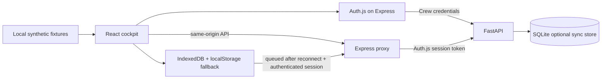

# HELIX — hackathon handoff

## 1. Concept selection

Scores are 1–5 (5 is best).

| Concept | Novelty | Feasibility | Judge impact | Challenge fit | Total |
|---|---:|---:|---:|---:|---:|
| **HELIX: Your body's flight computer** — a 3D Ghost Twin, explainable Health Runway, and One Thing Today | 5 | 4 | 5 | 5 | **19/20** |
| **Alternative 1: Mission Health Dashboard** — conventional telemetry vitals-and-alerts dashboard with status tables | 2 | 5 | 3 | 4 | 14/20 |
| **Alternative 2: Earth-Tethered Telemedicine Portal** — continuous cloud sync with asynchronous doctor chat and remote EHR | 1 | 3 | 2 | 2 | 8/20 |

**Concept trade-off analysis:**
- *Alternative 1 (Mission Health Dashboard)* is easy to build but lacks intuitive visual spatialization for non-physicians. It floods the astronaut with raw clinical numbers without answering the core questions: "Where am I drifting compared to my Earth baseline?", "How long before it needs intervention?", and "What single action should I take right now?"
- *Alternative 2 (Earth-Tethered Telemedicine Portal)* violates the deep-space communication reality of Mars/Artemis missions, where communication delay ranges up to 22 minutes one-way and comms blackouts are frequent. A tool that assumes real-time or near-real-time clinician intervention fails the core challenge requirement of astronaut *self-assessment*.
- **Selected Concept (HELIX)** was chosen because it directly addresses the 5 NASA hazards and 17 risks through a visual 3D Ghost Twin, provides transparent trend projections (Health Runway) rather than black-box diagnostic claims, and prioritizes a single actionable countermeasure (One Thing Today) while functioning 100% offline.

## 2. Pitch, users, and Earth benefits

**Pitch:** Astronauts on long missions need to understand changes in their own health when expert help is far away. HELIX turns personal baselines and routine self-checks into a visual Ghost Twin, a transparent trend runway, and one calm next step. It works offline, explains every measure in plain language, and keeps health data on the device unless the crew chooses to prepare an Earth summary. Every chart and reading in this demo is synthetic; HELIX is self-assessment support, not clinical software.

**Tagline:** Your body's flight computer.

**Target users:** astronauts and crew members in transit, on a station, lunar base, or planetary rover; flight surgeons reviewing a crew-prepared summary; educators demonstrating self-monitoring.

**Earth spin-offs:** remote clinics with unreliable connectivity, Antarctic and other isolated research stations, and older adults who want a plain-language view of self-recorded trends. These are design opportunities, not validated clinical deployments.

## 3. Architecture and data flow

The cloned frontend is **React 19 + Vite + TypeScript**, served by Express. The Python service is **FastAPI + SQLite**. The repo did not contain a Next.js app, so the working Vite cockpit was preserved. Auth.js runs through its Express integration; FastAPI validates Crew ID credentials and returns a short-lived service token that stays server-side.



**Folder map:** `frontend/src/components/` contains the original reused cockpit, onboarding, twin, measurement and summary UI; `frontend/src/lib/api.ts` holds client persistence, offline queue and API adapters; `frontend/server.ts` hosts Express, Auth.js, and the FastAPI proxy; `frontend/src/data/fixtures.ts` holds local UI fixtures; `frontend/src/data/risk-mapping.json` maps the 17 HELIX risk cards; `backend/app/main.py` provides auth, simulator, assessment, and sync endpoints; `backend/app/indicators.json` is the indicator library.

**Authentication flow:**

```text
Online: Sign-in form → Auth.js CSRF → Credentials provider → FastAPI /auth/login
      → signed Auth.js cookie → Express proxy uses server-side API token

Offline: Crew ID + password → locally salted PBKDF2 verifier → cached profile
      → all core views use local data; queued sync waits for connectivity and online sign-in

Guest: Continue as guest → local profile only → no authenticated health sync
```

## 4. Indicator library and threshold policy

The data-driven library is in [`backend/app/indicators.json`](backend/app/indicators.json). It covers blood pressure, heart rate, body temperature, blood glucose, sleep, mood/stress, exercise, radiation trend, and symptom reports. Each entry provides device-aware measurement steps, why it matters, hazard effects, source type, a reference-range note, actions, escalation wording, and all five required questions. The local fixtures provide a second offline UI rendering of these concepts.

**No clinical numeric thresholds are configured.** The challenge resources do not provide validated cutoffs, and this MVP does not claim NASA medical limits. User-entered readings are recorded for review; status/runway values are synthetic demo heuristics. Before adding numeric thresholds, the team must choose and cite reviewed public standards, label any demo thresholds as non-clinical, and have a qualified medical reviewer check them. Radiation values are relative only; official limits must come from mission/NASA standards.

Core source links: [NASA HRP hazards](https://www.nasa.gov/hrp/hazards/), [NASA HRP risks](https://www.nasa.gov/hrp/risks/), [NASA ongoing HRP research](https://www.nasa.gov/hrp/ongoing-hrp-research/), [NASA Human Research Roadmap risks](https://humanresearchroadmap.nasa.gov/Risks/), and [NASA-STD-3001 overview](https://www.nasa.gov/reference/3-0-health-and-medical-care/). Indicator-specific information should use the linked NASA risk/study pages already shown in the app. The CSA sources named in the challenge brief are included as follow-up research links in the app's learning/source library when the team supplies verified destination URLs.

## 5. Hazard → risk → region → indicator map

The app has 17 risk cards. The teamwork/coordination and human-systems-operations statements share one Crew & Mission card; both remain named in the entry. NASA's live HRP roadmap currently lists 22 risk records, so this is the challenge brief's 17-card product taxonomy, not a claim that NASA's current complete portfolio has only 17 risks.

| # | NASA risk concept | Body / context card | Indicators and routine | Hazard lens |
|---:|---|---|---|---|
| 1 | Radiation carcinogenesis | Radiation aura | Relative radiation-dose trend; solar-event review | Space radiation |
| 2 | CNS effects from radiation | Radiation aura / brain & eyes | Radiation trend; symptom report | Space radiation |
| 3 | Cardiovascular adaptations | Heart & vessels | Blood pressure, heart rate, orthostatic/landing checklist | Gravity, closed environment |
| 4 | Adverse cognitive/behavioral changes and psychiatric disorders | Mind & sleep | Mood/stress check-in, private journal | Isolation, distance |
| 5 | Sleep loss, circadian desynchronization, work overload | Mind & sleep | Sleep-hours sync, light and routine review | Isolation, distance, closed environment |
| 6 | Spaceflight-associated neuro-ocular syndrome (SANS) | Brain & eyes | Vision-change report and approved self-check | Gravity, distance |
| 7 | Altered sensorimotor/vestibular function | Inner ear & balance | Dizziness and coordination self-report | Gravity |
| 8 | Bone fracture from spaceflight bone changes | Bones & muscles | Exercise log; pain/injury report | Gravity |
| 9 | Reduced cardiorespiratory and musculoskeletal fitness | Bones & muscles / heart | Exercise minutes, heart rate | Gravity, closed environment |
| 10 | Altered immune response | Immune & skin | Temperature, rash and symptom report | Isolation, closed environment |
| 11 | Host-microorganism interactions | Immune & skin | Temperature and symptom report | Closed environment |
| 12 | Inadequate food and nutrition | Gut & metabolism | Glucose (when mission protocol calls for it), nutrition/hydration log | Closed environment, distance |
| 13 | Hypoxia | Lungs & oxygen | Breathing symptom report; optional approved SpO₂ device | Closed environment |
| 14 | Decompression sickness | Lungs & oxygen / EVA prep | EVA checklist and symptom report | Closed environment, distance |
| 15 | EVA injury and performance decrements | Crew & Mission / EVA checklist | Exercise/readiness log, heart rate, symptom report | Closed environment, gravity |
| 16 | Teamwork, coordination, communication, psychosocial adaptation, and human-systems operations support | Crew & Mission | Crew check-in and journal | Isolation, distance |
| 17 | Injury from dynamic loads | Crew & Mission / landing checklist | Injury/symptom report; landing prep | Gravity, closed environment |

The same 17-card mapping is stored in [`frontend/src/data/risk-mapping.json`](frontend/src/data/risk-mapping.json).

## 6. Runnable core and API

See [`frontend/README.md`](frontend/README.md) and [`backend/README.md`](backend/README.md) for setup. Start FastAPI on port 8000, then the existing Express/Vite app on port 3000. Demo credentials are `commander` / `commander-demo`.

FastAPI provides `/health`, `/auth/login`, `/auth/guest`, `/indicators`, `/stream/{profile_id}`, `/assessment/{profile_id}`, `/measurements`, `GET /packet/{profile_id}`, and authenticated `POST /packet/{profile_id}`. Express adds same-origin Auth.js routes and `/api/demo/dashboard`, `/api/measure`, and `/api/packet` adapters. A local fixture fallback keeps the cockpit usable when FastAPI is unavailable.

The four synthetic profiles have different baselines. Stressors include sleep debt, missed exercise, isolation stress, BP creep, CO₂ rise, radiation event, and EVA strain. Stream rows are deterministic by mission day and are marked `SYNTHETIC`.

## 7. 90-second demo script

| Time | Action / line |
|---|---|
| 0–10s | Sign in with the demo crew. “This runs without Google; health data stays on this device by default.” |
| 10–20s | Open day 63 in Transit. Point out the live-vs-baseline body, runway estimates, and synthetic-data label. |
| 20–35s | Inject sleep loss and missed exercise. Show sleep/mood and bones drift; explain the runway is a simple synthetic trend projection. |
| 35–48s | Inject BP creep and highlight isolation + distance as compounding context. |
| 48–60s | Read One Thing Today and its reason. State that recommendations are routine support, not treatment. |
| 60–70s | Open What-if and change sleep/exercise assumptions; explain the displayed deltas are scenario math on synthetic streams. |
| 70–82s | Simulate comms loss. Record a measurement; show the local queue remains usable. |
| 82–90s | Generate the one-page summary and show it queued/stored for demo sync—not sent to a real surgeon. |

## 8. Ethics and limitations

- No real astronaut dataset was provided. Every sample stream and runway estimate is synthetic.
- The interface is not a medical device, diagnostic tool, or treatment recommender. It does not prescribe medication, supplements, fluid amounts, or clinical retest intervals.
- Serious or worsening findings direct the crew to mission protocols and the flight surgeon. Rewards are for honest check-ins and healthy behavior, never symptom suppression.
- Health data remains local unless a signed-in user explicitly submits a demo sync. The demo API stores measurements/packets in SQLite and is not connected to NASA or an actual Earth link.
- Offline is the core mode. OAuth and remote sync degrade when disconnected. IndexedDB is mirrored to localStorage as a browser fallback; local password verification is salted PBKDF2.
- The Auth.js Express adapter is experimental upstream. Use a unique `AUTH_SECRET`, TLS, secure host configuration, account lifecycle controls, and security review before any real deployment.
- The included synthetic simulator's status bands and projected days are illustrative and do not represent medical thresholds or mission exposure limits.

## 9. Three-minute pitch and judge questions

**Pitch script (about 3 minutes):**

“A Mars crew cannot wait for Earth to explain every change in how they feel. HELIX is the body's flight computer: where am I, how long until a trend may need attention, and what can I do today?

Here is Commander Demo, day 63 in transit. The body view compares a synthetic mission trend with a personal Earth baseline. The runway is transparent: it is a simple projection from sample data, not a clinical prediction. When I add sleep debt and missed exercise, the mind and bone systems drift. Then I add BP creep. The hazard lens shows why isolation, gravity, a closed habitat, and communication delay can compound the picture.

HELIX chooses one small, explainable action and names the reason. It labels approved self-care as Recommended and research as Under study. It does not prescribe medication, fluid amounts, or an astronaut's medical thresholds. A serious or worsening symptom means follow mission procedure and contact the flight surgeon.

The crew can still open the self-check guide, review lessons, log a measure, and see local trends without a link. A summary is created locally and waits for an authenticated connection. No health record silently leaves the device. The demo crew works without Google, and no real astronaut data is implied: every profile and chart on screen is synthetic.

HELIX is useful in space because it makes routine self-assessment understandable when Earth is far away. The same offline-first pattern could help isolated clinics, Antarctic stations, and people tracking their own health at home. HELIX does not replace a clinician; it helps a person notice, understand, and communicate a change.”

**Eight hard judge questions:**

1. **Where is the astronaut dataset?** None was supplied. We clearly label all profiles and streams synthetic and use them only to demonstrate the workflow.
2. **How do you know the thresholds are safe?** We do not set clinical thresholds. The backend records values and trend projections are explicitly demo heuristics. Mission-approved limits must come from flight medicine.
3. **Does the runway predict a medical event?** No. It is an explainable linear trend over synthetic data, with low confidence. It is not a forecast or clinical alert.
4. **What happens during comms blackout?** The PWA app shell and core local functions continue; readings and summary drafts stay in IndexedDB and queue for authenticated sync.
5. **Can Google be required for the demo?** No. Use the seeded `commander` crew account or a local guest profile.
6. **How is private health data protected?** It stays on-device by default. Explicit sync uses an authenticated session; demo SQLite storage is local and contains demo submissions only.
7. **Why use five hazards as the top-level model?** It follows NASA HRP's organizing framework; the risk library connects hazards to body systems and indicators, showing compound context.
8. **What would it take to use this on a real mission?** Medical review, mission-specific standards and thresholds, validated devices, usability testing with crew, security review, and integration with approved mission communications and health systems.

## 10. Challenge objective and consideration coverage

| Challenge statement / consideration from the supplied brief | HELIX feature |
|---|---|
| Create health monitoring software for astronauts on missions | Visual Twin, local assessment, mission environment and health trend views |
| Crew should assess their own health | Guided Measure flow, plain-language Five Questions, personal baseline comparison |
| Inputs may be typed values, clicks, or camera data | Typed measurement and self-report controls; camera-based diagnosis is out of scope |
| Show which measures can be performed in space | Each indicator's Five Questions and micro-guidance |
| Explain why an exam is needed | `why_needed` text and contextual “Why?” links |
| Explain hazard effects | Five-hazard lens and region-to-hazard links |
| Explain when crew or surgeon should attend | Conservative symptom language; mission procedures and flight-surgeon direction |
| Explain preventive actions | Recommended NASA-aligned routines; Under study tags for experimental ideas |
| Clickable human figure and status | Reused 3D twin with 2D fallback and tappable anatomical regions |
| Environments: spacecraft, station, rover, planetary base | Environment selector and gravity/context adjustments |
| Routine prompts and guided measurements | Existing routine rings and measurement wizard; mission medical schedule remains authoritative |
| Gamification | Measure/Move/Rest/Connect rings reward logging and healthy behavior; no symptom-hiding rewards |
| Dynamic charts and color status | Local fixture trends, backend synthetic stream, runway chart, color-safe status treatment |
| Simple instructions for novices | Experience level, simple summaries, glossary and Flight School |
| Passive and active data | Active forms plus synthetic passive sleep/activity/radiation streams; cabin telemetry remains illustrative |
| Combined plus per-hazard status | Combined header status and individual hazard lens; synthetic demo status only |
| Environment-aware drift and countermeasures | Mission environment and gravity context; no real mission limit is encoded |
| Synthetic simulator, four different baselines, multi-day streams and stressors | FastAPI simulator and stressor injection endpoints |
| Summary for delayed Earth communication | One-page summary can be prepared and queued; no real transmission is claimed |
| PWA/offline-first | Service worker shell cache, IndexedDB state, local fixtures, PBKDF2 offline unlock and queued retry |

## Auth.js Google setup

Create a Google Cloud OAuth client of type Web application. Add `http://localhost:3000/auth/callback/google` for local development and `https://YOUR_HOST/auth/callback/google` for deployment. Set `GOOGLE_CLIENT_ID`, `GOOGLE_CLIENT_SECRET`, `AUTH_SECRET`, and `AUTH_URL`. The Google button is absent unless both Google credentials and the Auth secret are present. Demo Crew ID/password continues to work without Google.

## 11. Final Phase 4 status (2026-11-14)

- Fixture review removed app-provided hydration quantities, timed measurement instructions, numeric symptom cutoffs, exact dose units, exact bpm comparisons, and specific what-if day gains. Guidance now points to mission procedures or is marked illustrative/under study. The radiation fixture is a relative synthetic trend and explicitly defers official exposure limits to mission/NASA standards. The published bone-density change fact remains because it is supplied in the challenge brief.
- `npm run lint` (TypeScript `tsc --noEmit`): passed.
- `npm run build`: passed. Vite reports its existing `__dirname` config notice and a large 3D chunk warning; neither fails the build.
- Demo crew credentials were exercised through the Auth.js credential callback; `/auth/session` returned the Commander Demo profile. The synthetic day-63 dashboard and authenticated summary packet API returned successfully.
- Flight School, Twin selection/rotation, solar-flare controls, and Surgeon Packet copy behavior were source-reviewed and compile-checked. Solar injection updates the Twin/runway locally and forwards the stressor through `/api/demo/dashboard`; copy uses the Clipboard API with a browser fallback. No browser automation/runtime was available to click through these UI actions.
- The pre-existing dev servers were already running. The live proxy process predates the final source change that attaches the requested stressor list to the dashboard response, so a complete live UI verification of solar-flare propagation remains outstanding. Restart the API and frontend from the documented commands, then click through sign-in, Flight School, Twin, Solar flare, and Copy plain text once in a browser.
- No commits, pushes, or deployments were made.
